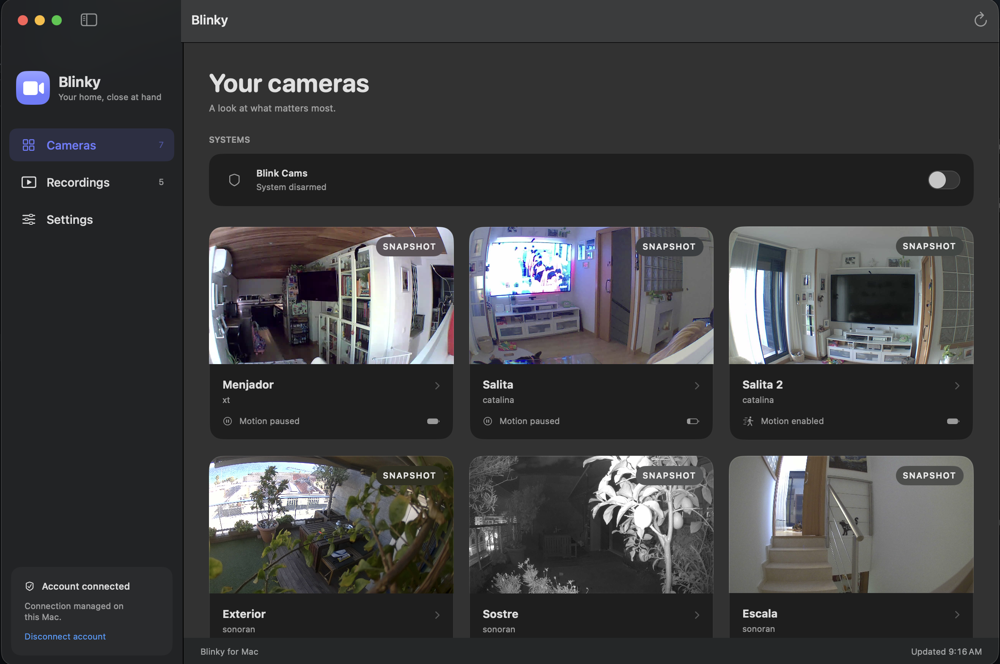
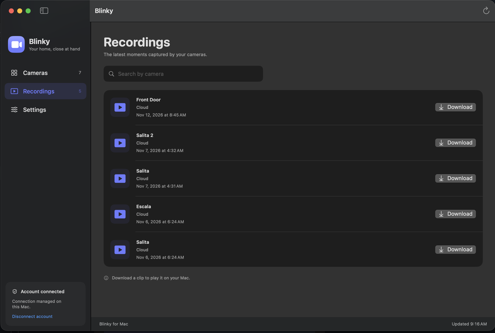
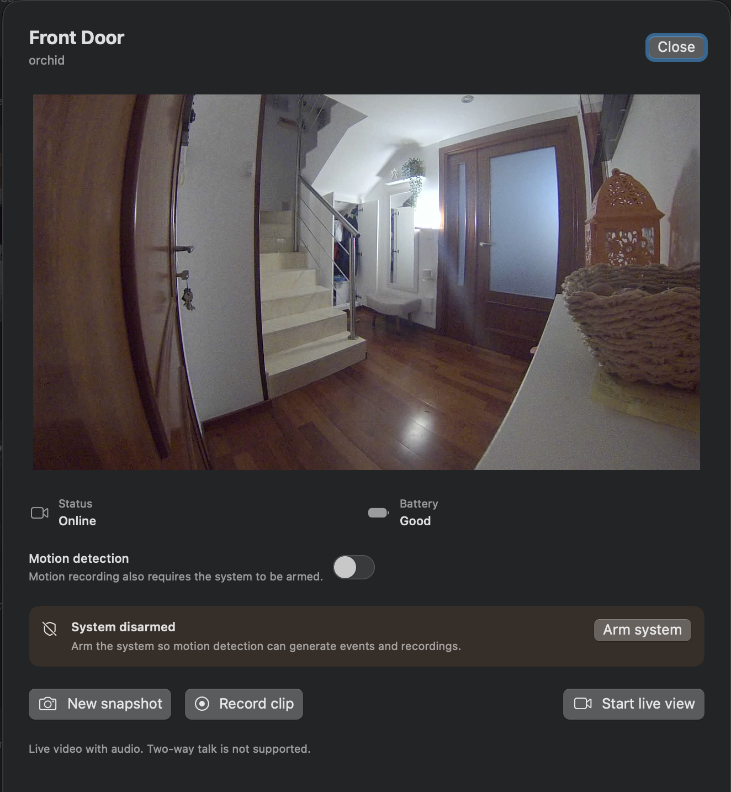

# Blinky

A native macOS app for accessing your Blink cameras from your Mac. The interface uses SwiftUI and connects to Blink through a small Python process using [blinkpy](https://github.com/fronzbot/blinkpy). This is an independent project, with no affiliation with Blink or Amazon.

## Quick start

- macOS 14 or later.
- Xcode 15.3 or later, with Swift 5.10 or later.
- Python 3.10 or later to connect a Blink account. Demo mode does not require Python.
- FFmpeg for live video. Standard Homebrew locations are detected automatically; `BLINKY_FFMPEG` can select another executable.

From the repository directory, run the following commands to create a local Python environment, build Blinky, and open the app.

```bash
./scripts/bootstrap.sh
./scripts/build-app.sh
open dist/Blinky.app
```

## Try the demo

From the project directory:

```sh
./scripts/run.sh --demo
```

Blinky opens with sample data so you can explore the interface without connecting cameras. Without `--demo`, it displays the sign-in screen or restores your saved session. You can also open `Package.swift` in Xcode and run the Blinky scheme.

## Screenshots

### Cameras



### Recordings



### Camera controls



## Connect your cameras

First, prepare the local Python environment:

```sh
./scripts/bootstrap.sh
./scripts/run.sh
```

The first command creates `.venv` and installs the blinkpy version specified in `Sources/Blinky/Bridge/requirements.txt`. It prefers Python 3.13/3.12/3.11/3.10 when available and falls back to `python3`. You can choose an interpreter with `BLINKY_BOOTSTRAP_PYTHON=/path/to/python3 ./scripts/bootstrap.sh`. The script does not install system tools or require `sudo`.

Connect your Blink account in the app and complete any verification requested by Blink. Connecting a real account requires Internet access. You do not need to keep Blinky open to continue using the official Blink app.

## Build an app for Finder

The build script creates a release build at `dist/Blinky.app` with its icon and a local ad hoc signature. It does not install the app in `/Applications` or use developer certificates. Quit a running copy before opening the rebuilt application.

If you have run `bootstrap.sh`, the generated app stores the path to the `.venv` interpreter in `Info.plist`. Keep the project directory at that location. If you move it, prepare the environment and build the app again. This package is intended for local use: it does not yet bundle a Python interpreter for distribution and is not notarized.

To use a different interpreter when running from Terminal:

```sh
BLINKY_PYTHON=/path/to/python3 ./scripts/run.sh
```

The interpreter must have the bridge dependencies installed. `BLINKY_BRIDGE_PATH` lets you specify a different path to `bridge.py` during development.

## Current scope

The app includes sign-in and two-step verification, session restoration through Keychain, system and camera lists, snapshot and recording requests, system and motion detection controls, and manual MP4 clip export. The bridge implementation is in place; it still needs validation with a real account and cameras.

Recordings include cloud clips and Sync Module USB clips. Cloud results are paginated without a 48-hour filter. The combined list is bounded to 500 entries, and each download is limited to 20 MB. Source failures appear as warnings and preserve the last available list. Availability still depends on your account and storage configuration. See [the protocol and its limits](docs/bridge.md).

Open a camera and choose **Start live view** for video with listening audio. Use the full-screen button in the player controls to enlarge the video and press **Esc** to return to the camera view. Sessions are bounded to 90 seconds and may end sooner when Blink closes them. Stop the view or close the camera to release it. The bridge converts the Blink stream to temporary HLS with FFmpeg and serves it only on loopback to the native player. It does not provide two-way talk or continuous recording. Real camera and relay compatibility still require account-level validation.

System and motion controls wait for command completion and verify the refreshed server state. Arming enables recording on motion; it does not create an immediate clip. Enabling motion on a camera does not automatically arm the whole system. A recording request is shown as completed only after a new clip is discovered; otherwise the app reports that its availability remains unconfirmed.

Choose **English**, **Español**, or **Català** in Settings. The selection takes effect immediately and is saved for future launches. The icon can be regenerated with `swift scripts/generate-icon.swift`.

Blink uses cloud services and a community integration. Changes to authentication or protocol may require updates. Opening live views and requesting images frequently can increase battery consumption.

## Development and checks

```sh
swift test
swift build -c release
python3 -m unittest discover -s Tests/Python -p 'test_*.py'
```

The bridge tests run without a Blink account. The real connection, camera content, and account authentication require manual verification.

Do not commit passwords, verification codes, tokens, clips, or logs containing private data to the repository. `.gitignore` excludes `.venv`, build output, and `.env` files.
